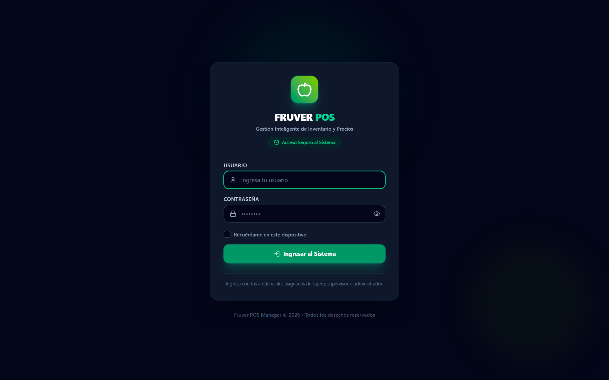
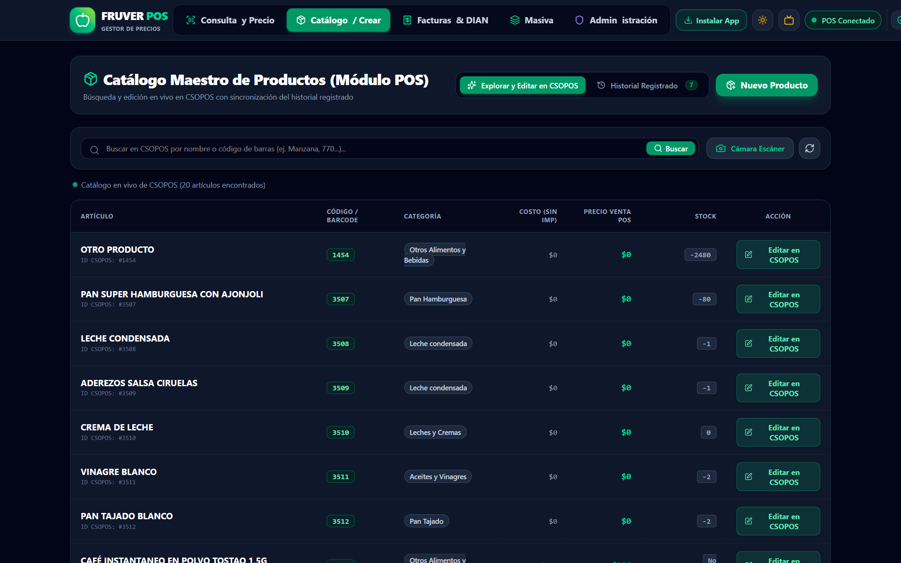
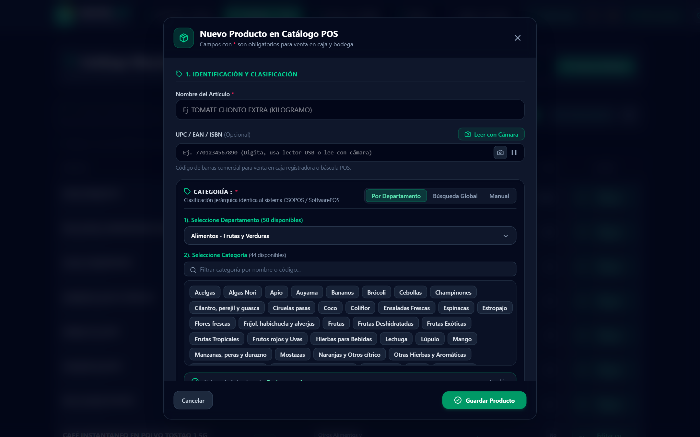
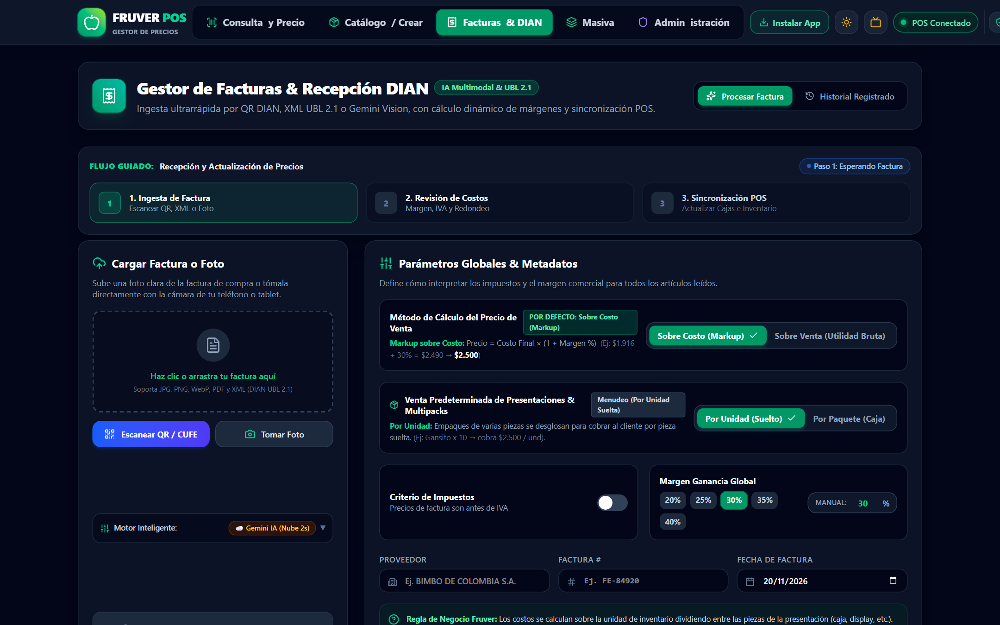
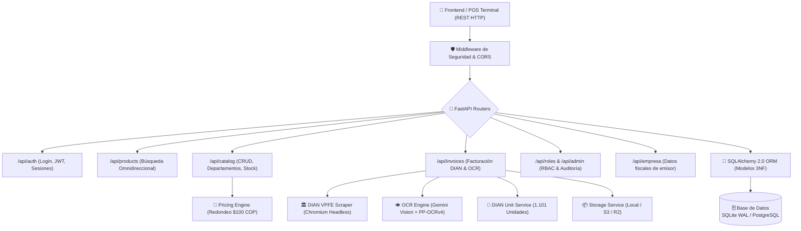
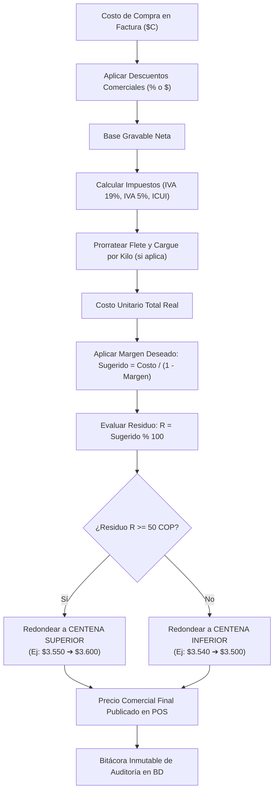
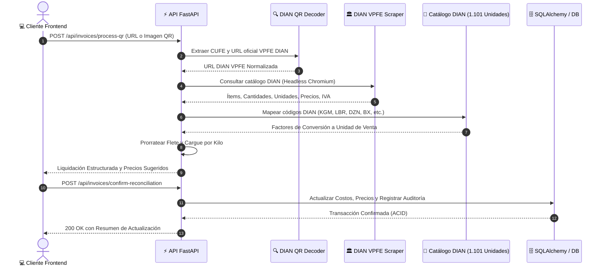
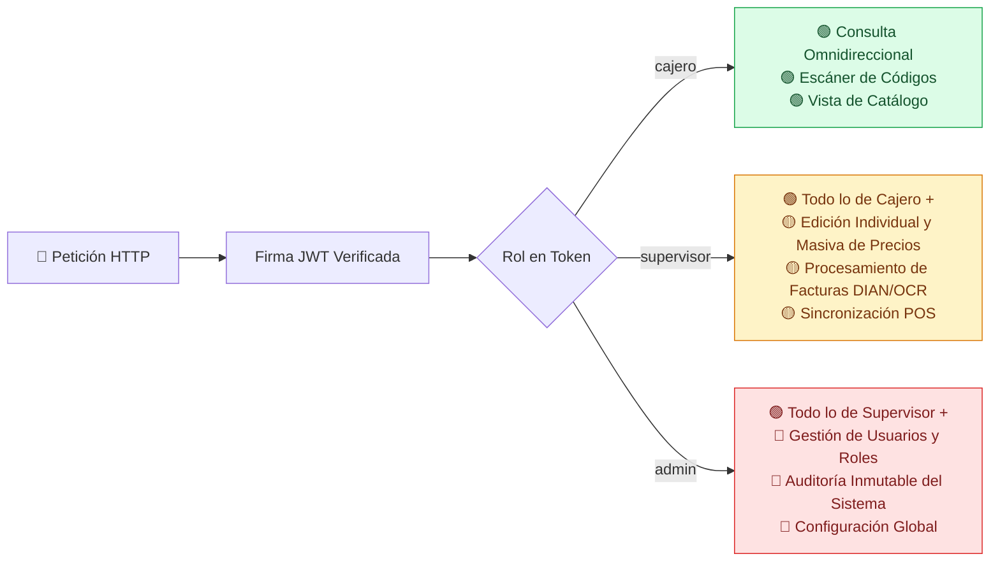

# ⚡ Fruver POS Backend API & Core Services

[](https://www.python.org/)
[](https://fastapi.tiangolo.com/)
[](https://www.sqlalchemy.org/)
[](https://www.sqlite.org/)
[](https://www.postgresql.org/)
[](https://www.docker.com/)
[-22c55e?style=for-the-badge&logo=pytest&logoColor=white)]()
[](LICENSE)

Backend de alto rendimiento desarrollado con **FastAPI** para el sistema **Fruver POS**. Proporciona una API REST modular, autenticación y autorización basada en roles (**RBAC** con JWT y Bcrypt), motor de precios comerciales con regla de **redondeo a centenas ($100 COP)**, asistente de facturación electrónica (**DIAN VPFE**), motor OCR dual (Gemini Vision + PaddleOCR ONNX) y catálogo maestro de 1.101 unidades de medida oficiales DIAN.

---

## 📸 Módulos del Sistema Gestionados por la API

| Control de Acceso (JWT & Bcrypt) | Catálogo Maestro & Búsqueda Omnidireccional |
| :---: | :---: |
|  |  |
| *Sesiones seguras, hashing Bcrypt estricto y roles RBAC* | *Búsqueda en tiempo real, filtros dinámicos y control de inventario* |

| Motor de Precios ($100 COP) | Facturas Electrónicas DIAN & OCR |
| :---: | :---: |
|  |  |
| *Cálculo de base gravable, IVA, fletes y regla a la centena* | *Scraping headless de DIAN VPFE, OCR dual y prorrateo de costos* |

---

## 🏗️ Arquitectura de la API



---

## 🧮 Motor de Precios & Regla Comercial de Redondeo

El servicio `app.services.pricing_engine` implementa las reglas de cálculo financiero y redondeo comercial colombiano:



---

## 🧾 Flujo del Asistente DIAN VPFE & Liquidación



---

## 🔐 Matriz de Permisos RBAC



| Permiso | Endpoint Scope | Admin | Supervisor | Cajero |
| :--- | :--- | :---: | :---: | :---: |
| `can_lookup` | `GET /api/products/*`, `GET /api/catalog/*` | ✅ | ✅ | ✅ |
| `can_edit_single` | `PUT /api/products/price/*`, `PUT /api/catalog/products/*` | ✅ | ✅ | ❌ |
| `can_edit_bulk` | `POST /api/products/bulk-update` | ✅ | ✅ | ❌ |
| `can_process_invoices` | `POST /api/invoices/*`, `POST /api/invoices/process-qr` | ✅ | ✅ | ❌ |
| `can_view_audit` | `GET /api/auditoria/*` | ✅ | ✅ | ❌ |
| `can_sync_pos` | `POST /api/pos/sync` | ✅ | ✅ | ❌ |
| `can_manage_users` | `GET/POST/PUT/DELETE /api/admin/users/*` | ✅ | ❌ | ❌ |

---

## 📁 Estructura del Repositorio

```text
fruver-pos-backend/
├── app/
│   ├── core/                       # Configuración (.env), SQLAlchemy engine, JWT, Bcrypt
│   ├── models/                     # Modelos relacionales 3NF y esquemas Pydantic
│   ├── routers/                    # Endpoints modulares (auth, products, catalog, invoices, admin)
│   ├── services/                   # Motores de pricing, DIAN units, scrapers y OCR
│   ├── data/                       # Catálogos maestros (1.101 códigos de unidades DIAN)
│   └── main.py                     # Instancia principal FastAPI y middlewares
├── tests/                          # Suite de 40 pruebas automatizadas con Pytest
├── scripts/                        # Scripts de migración de BD, almacenamiento y utilidades
├── models_ocr/                     # Directorio reservado para pesos OCR locales (PP-OCRv4)
├── storage/                        # Almacenamiento local desacoplado (invoices, exports, temp)
├── backups/                        # Respaldos automáticos de base de datos
├── docs/screenshots/               # Capturas visuales de referencia
├── .dockerignore                   # Exclusiones de Docker
├── .env.example                    # Plantilla documentada de variables de entorno
├── .gitignore                      # Exclusiones estrictas de Git
├── Dockerfile                      # Imagen ligera de producción con Python 3.12-slim
├── LICENSE                         # Licencia abierta MIT
├── pytest.ini                      # Configuración de pruebas
└── requirements.txt                # Dependencias de producción
```

---

## 🚀 Instalación y Puesta en Marcha

### Prerrequisitos
- **Python 3.10, 3.11 o 3.12**.
- **Pip** y **Git**.

### 1. Clonar el Repositorio
```bash
git clone https://github.com/williamfraile84/Backend-Inventario.git
cd Backend-Inventario
```

### 2. Crear y Activar Entorno Virtual
```bash
# En Windows:
python -m venv venv
.\venv\Scripts\activate

# En Linux / macOS:
python3 -m venv venv
source venv/bin/activate
```

### 3. Instalar Dependencias
```bash
pip install -r requirements.txt
```

### 4. Configurar Variables de Entorno
```bash
# En Windows:
copy .env.example .env

# En Linux / macOS:
cp .env.example .env
```
Edita `.env` para personalizar tu clave secreta JWT (`SECRET_KEY`), motor de base de datos (`DB_ENGINE=sqlite` o `DB_ENGINE=postgresql`), etc.

### 5. Iniciar la API en Modo Desarrollo
```bash
uvicorn app.main:app --reload --host 0.0.0.0 --port 8000
```

- **Swagger UI interactivo**: [http://localhost:8000/docs](http://localhost:8000/docs)
- **Documentación ReDoc**: [http://localhost:8000/redoc](http://localhost:8000/redoc)
- **Health Check**: [http://localhost:8000/health](http://localhost:8000/health)

---

## 🐳 Despliegue con Docker

Construye y levanta el contenedor con un solo comando:

```bash
# Construir imagen
docker build -t fruver-pos-backend .

# Ejecutar contenedor
docker run -d -p 8000:8000 --name fruver-backend --env-file .env fruver-pos-backend
```

---

## 🧪 Pruebas Automatizadas (Pytest)

Ejecuta la suite completa de 40 pruebas automatizadas:

```bash
pytest -v
```

---

## 📄 Licencia
Este proyecto está bajo la Licencia abierta [MIT](LICENSE).
